  

  

<!-- PROJECT_CARD_START -->
<h3>⚡ Recent Transmissions · last 7 days</h3>
<table>
  <thead>
    <tr>
      <th>#</th>
      <th>Project</th>
      <th>Authored Stack</th>
      <th>Last Commit</th>
      <th>Rank</th>
    </tr>
  </thead>
  <tbody>
  <tr>
    <td align="center"><code>01</code></td>
    <td>🔒 <code>classified</code></td>
    <td>    </td>
    <td align="center">1d ago</td>
    <td align="center">🏆 <b>Solo</b></td>
  </tr>
  <tr>
    <td align="center"><code>02</code></td>
    <td>🔒 <code>classified</code></td>
    <td>   </td>
    <td align="center">1d ago</td>
    <td align="center">🏆 <b>Solo</b></td>
  </tr>
  <tr>
    <td align="center"><code>03</code></td>
    <td>🔒 <code>classified</code></td>
    <td></td>
    <td align="center">1d ago</td>
    <td align="center">🏆 <b>Solo</b></td>
  </tr>
  <tr>
    <td align="center"><code>04</code></td>
    <td>🔒 <code>classified</code></td>
    <td></td>
    <td align="center">1d ago</td>
    <td align="center">🏆 <b>Solo</b></td>
  </tr>
  <tr>
    <td align="center"><code>05</code></td>
    <td>🔒 <code>classified</code></td>
    <td>     </td>
    <td align="center">1d ago</td>
    <td align="center">🏆 <b>Solo</b></td>
  </tr>
  <tr>
    <td align="center"><code>06</code></td>
    <td>🔒 <code>classified</code></td>
    <td>   </td>
    <td align="center">2d ago</td>
    <td align="center">🥉 <b>3</b>/3</td>
  </tr>
  <tr>
    <td align="center"><code>07</code></td>
    <td>🔒 <code>classified</code></td>
    <td>     </td>
    <td align="center">3d ago</td>
    <td align="center">🏆 <b>Solo</b></td>
  </tr>
  <tr>
    <td align="center"><code>08</code></td>
    <td>🔒 <code>classified</code></td>
    <td>     </td>
    <td align="center">5d ago</td>
    <td align="center">🏆 <b>Solo</b></td>
  </tr>
  <tr>
    <td align="center"><code>09</code></td>
    <td>🔒 <code>classified</code></td>
    <td>     </td>
    <td align="center">6d ago</td>
    <td align="center">🏆 <b>Solo</b></td>
  </tr>
  </tbody>
</table>
<!-- PROJECT_CARD_END -->

 

<picture>
  <source media="(prefers-color-scheme: dark)" srcset="https://raw.githubusercontent.com/sagawrr/sagawrr/output/snake-dark.svg"/>
  
</picture>

  

<!-- LAST_UPDATED_START -->

<!-- LAST_UPDATED_END -->

