  

<!-- STACK_START -->

<!-- STACK_END -->

  

<!-- PROJECT_CARD_START -->
<h3>⚡ Active Projects — Past 7 Days</h3>
<table>
  <thead>
    <tr>
      <th>#</th>
      <th>Project</th>
      <th>Stack</th>
      <th>Activity (7d)</th>
      <th>Rank</th>
    </tr>
  </thead>
  <tbody>
    <tr>
      <td align="center"><code>01</code></td>
      <td>🔒 <code>neon-nebula</code> classified</td>
      <td>   </td>
      <td align="center"><code>·····█·</code> 1 commit</td>
      <td align="center">🏆 <b>Solo</b></td>
    </tr>
    <tr>
      <td align="center"><code>02</code></td>
      <td>🔒 <code>phantom-drift</code> classified</td>
      <td>  </td>
      <td align="center"><code>·····█·</code> 100+ commits</td>
      <td align="center">🏆 <b>Solo</b></td>
    </tr>
    <tr>
      <td align="center"><code>03</code></td>
      <td>🔒 <code>neon-prism</code> classified</td>
      <td></td>
      <td align="center"><code>····█▅·</code> 36 commits</td>
      <td align="center">🏆 <b>Solo</b></td>
    </tr>
    <tr>
      <td align="center"><code>04</code></td>
      <td>🔒 <code>solar-kernel</code> classified</td>
      <td></td>
      <td align="center"><code>···▂█▇·</code> 100+ commits</td>
      <td align="center">🏆 <b>Solo</b></td>
    </tr>
    <tr>
      <td align="center"><code>05</code></td>
      <td>🔒 <code>solar-circuit</code> classified</td>
      <td>     </td>
      <td align="center"><code>····█▇·</code> 20 commits</td>
      <td align="center">🏆 <b>Solo</b></td>
    </tr>
    <tr>
      <td align="center"><code>06</code></td>
      <td>🔒 <code>feral-kernel</code> classified</td>
      <td> </td>
      <td align="center"><code>····█··</code> 2 commits</td>
      <td align="center">🥉 <b>#3</b> of 3</td>
    </tr>
    <tr>
      <td align="center"><code>07</code></td>
      <td>🔒 <code>hollow-orbit</code> classified</td>
      <td>    </td>
      <td align="center"><code>···█···</code> 2 commits</td>
      <td align="center">🏆 <b>Solo</b></td>
    </tr>
    <tr>
      <td align="center"><code>08</code></td>
      <td>🔒 <code>lunar-ember</code> classified</td>
      <td>    </td>
      <td align="center"><code>·█·····</code> 3 commits</td>
      <td align="center">🏆 <b>Solo</b></td>
    </tr>
    <tr>
      <td align="center"><code>09</code></td>
      <td>🔒 <code>echo-signal</code> classified</td>
      <td>    </td>
      <td align="center"><code>·█·····</code> 2 commits</td>
      <td align="center">🏆 <b>Solo</b></td>
    </tr>
  </tbody>
</table>
<!-- PROJECT_CARD_END -->

 

  

<!-- LAST_UPDATED_START -->

<!-- LAST_UPDATED_END -->

